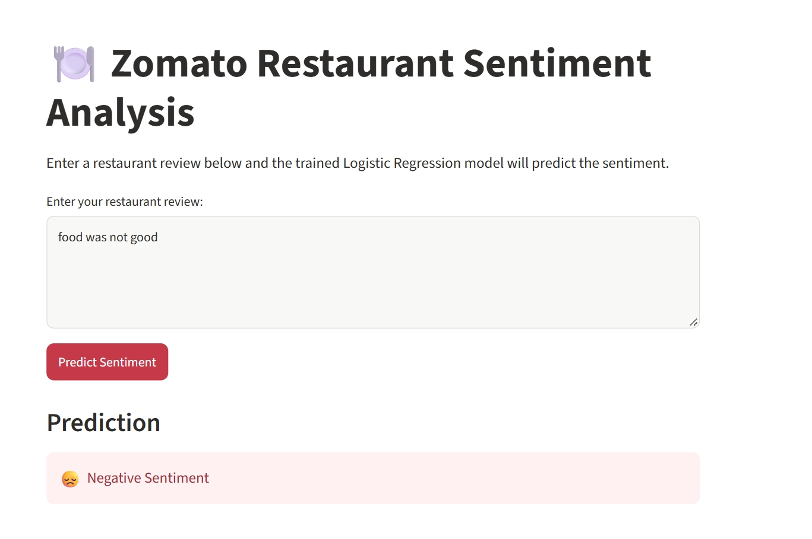
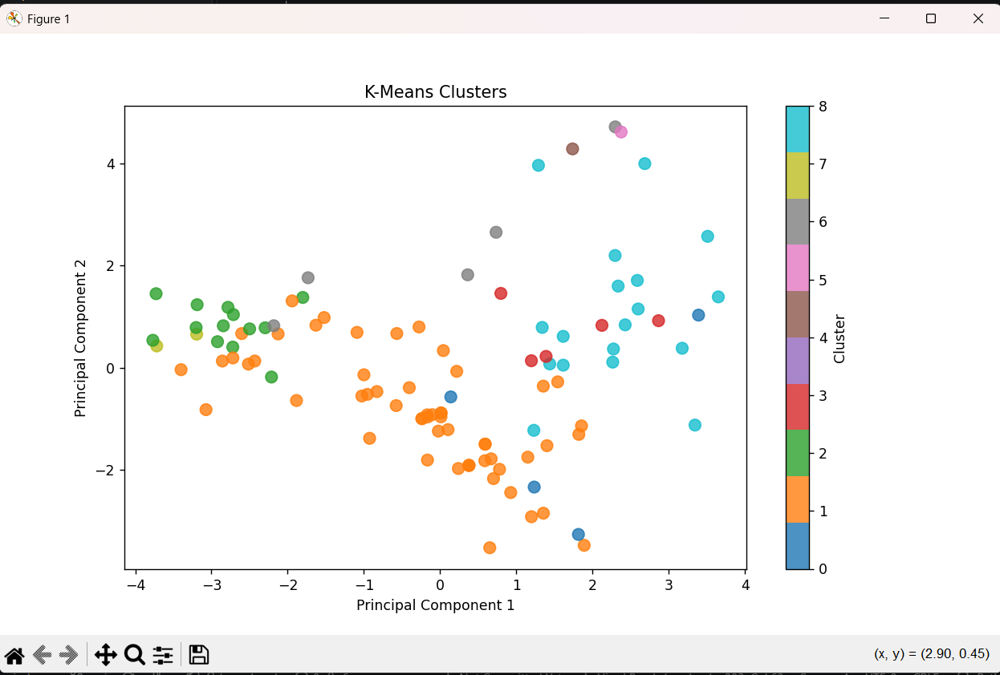

# 🍽️ Zomato Restaurant Clustering & Sentiment Analysis

[](https://zomato-restaurant-clustering-sentiment-analysis.streamlit.app)
[](https://github.com/Ujwal-Bamb/zomato-restaurant-clustering-sentiment-analysis.git)


> **Dual-Pillar Machine Learning & NLP Platform**: Combines negation-preserving customer review sentiment classification (89.86% F1) with PCA dimensionality reduction, K-Means restaurant clustering ($K=9$), and formal parametric & non-parametric statistical hypothesis testing ($p < 0.0001$).

---

## 🔗 Live Application & Repository

- **Live Application**: [https://zomato-restaurant-clustering-sentiment-analysis.streamlit.app](https://zomato-restaurant-clustering-sentiment-analysis.streamlit.app)
- **Source Code**: [https://github.com/Ujwal-Bamb/zomato-restaurant-clustering-sentiment-analysis.git](https://github.com/Ujwal-Bamb/zomato-restaurant-clustering-sentiment-analysis.git)

---

## 📸 Screenshots

> *Add your application screenshots to `docs/screenshots/` using the exact paths below to render them automatically:*

| Real-Time Sentiment Prediction UI | PCA Cluster Visualization ($K=9$) |
| :---: | :---: |
|  |  |
| *Review text input with sentiment classification & confidence* | *2D/3D PCA projection of K-Means restaurant archetypes* |

---

## 🎯 Executive Overview & Business Value

Online food aggregators and restaurant platforms manage tens of thousands of dining establishments and millions of customer reviews. Business stakeholders face two core analytical challenges:
1. **Unstructured Review Volatility**: Thousands of customer reviews contain nuanced feedback that cannot be tracked manually without automated NLP sentiment triage.
2. **Latent Market Segmentation**: Restaurants cannot be evaluated on rating alone; understanding market clusters (e.g., high-cost fine dining vs. budget high-volume street food) requires multi-attribute clustering.

This repository provides an end-to-end modular machine learning solution tackling both challenges with statistical and mathematical rigor.

---

## 🔬 Pillar 1: Customer Review Sentiment Classification (NLP)

### 1. Negation-Preserving NLP Preprocessing (`src/nlp_preprocessing.py`)
- Standard stopword removal introduces critical sentiment distortion (e.g., converting *"food was not good"* into *"food good"*).
- **Custom Preprocessing Pipeline**:
  - Contractions expansion (e.g., *"didn't"* $\rightarrow$ *"did not"*).
  - Explicit retention of contextual negation operators (`not`, `never`, `no`, `neither`, `nor`).
  - Text normalization, lowercasing, regex punctuation handling, and lemmatization.

### 2. Feature Extraction & Stratified Validation
- **Vectorization**: Extracted 5,000 unigram and bigram TF-IDF features (`ngram_range=(1, 2)`, `min_df=3`).
- **Validation Scheme**: Evaluated across 9,954 customer reviews using an **80/20 Stratified Train-Test Split** followed by **5-Fold Stratified GridSearchCV** hyperparameter tuning.

### 3. Model Benchmark & Evaluation Results
Benchmarked multiple supervised classifiers tracked with **MLflow**:

| Model | F1-Score | Accuracy | Precision | Recall | Status |
| :--- | :---: | :---: | :---: | :---: | :---: |
| **Tuned Logistic Regression** | **89.86%** | **87.29%** | **90.33%** | **89.39%** | **Selected Production Model** |
| **Linear Support Vector Classifier (LinearSVC)** | 89.62% | 86.85% | 89.92% | 89.32% | Evaluated |
| **Multinomial Naive Bayes (MultinomialNB)** | 89.29% | 86.10% | 88.75% | 89.84% | Baseline |

### 4. Model Explainability with SHAP (`src/sentiment_model.py`)
- Integrated SHAP explainability to quantify exact word importance.
- Words with strongest positive attribution: `delicious`, `amazing`, `friendly`, `great`, `fresh`.
- Words with strongest negative attribution: `worst`, `pathetic`, `cold`, `horrible`, `disappointed`.
- Artifacts serialized via Joblib (`models/zomato_sentiment_model.joblib`) for sub-10ms real-time Streamlit inference.

---

## 📊 Pillar 2: Restaurant Clustering & Hypothesis Testing

### 1. Dimensionality Reduction with PCA (`src/feature_engineering.py`)
- Ingested restaurant metadata across cost, rating, vote count, and **44 multi-label one-hot encoded cuisine categories** (46 total features).
- Applied Principal Component Analysis (PCA): Reduced 46 dimensions down to **30 principal components explaining 90.12% of the cumulative variance**.

### 2. Unsupervised Clustering Benchmark (`src/clustering_pipeline.py`)
Evaluated clustering quality using Silhouette, Calinski-Harabasz, and Davies-Bouldin metrics:

| Clustering Algorithm | Optimal Clusters ($K$) | Silhouette Score | Calinski-Harabasz | Davies-Bouldin | Finding |
| :--- | :---: | :---: | :---: | :---: | :--- |
| **K-Means Clustering** | **$K = 9$** | **0.1543** | **54.89** | **1.62** | **Selected Model**: Cohesive functional restaurant segments |
| **Agglomerative Hierarchical** | $K = 2$ | 0.1299 | 32.14 | 2.10 | Oversimplified binary split (Budget vs Luxury) |

#### Identified Restaurant Archetypes ($K=9$):
1. *Premium Fine Dining & Multi-Cuisine*
2. *Budget Quick Bites & Fast Food*
3. *Specialty Cafés & Dessert Parlors*
4. *Pubs, Microbreweries & Nightlife*
5. *Authentic Regional Casual Dining*

### 3. Formal Statistical Hypothesis Testing (`src/hypothesis_testing.py`)
Replaced guesswork with rigorous parametric and non-parametric statistical testing:
- **Test 1: Cost vs. Average Rating**:
  - *Method*: Spearman Rank Correlation (non-normal distributions).
  - *Result*: **$\rho = 0.3826$, $p < 0.0001$**.
  - *Conclusion*: Statistically significant moderate positive relationship; higher-priced dining experiences correlate with higher customer satisfaction.
- **Test 2: Review Volume vs. Average Rating**:
  - *Method*: Spearman Rank Correlation.
  - *Result*: **$\rho = 0.4796$, $p < 0.0001$**.
  - *Conclusion*: Statistically significant positive association between customer engagement volume and rating reliability.
- **Test 3: High-Rating Proportion Variance Across Cuisines**:
  - *Method*: Two-Proportion Z-Test.
  - *Result*: **$Z = 26.84$, $p < 0.0001$**.
  - *Conclusion*: Statistically significant divergence in high-rating rates across distinct cuisine categories.

---

## 📁 Repository Structure

```
zomato-restaurant-clustering-sentiment-analysis/
├── data/
│   ├── Zomato Restaurant names and Metadata (1).csv  # Restaurant attributes & metadata
│   └── Zomato Restaurant reviews (1).csv             # Raw 9,954 customer review texts
├── docs/
│   └── screenshots/                                  # Application screenshot placeholders
│       ├── sentiment_app.png
│       ├── clustering_pca.png
│       ├── shap_waterfall.png
│       └── hypothesis_testing.png
├── models/
│   └── zomato_sentiment_model.joblib                 # Serialized model + TF-IDF vectorizer
├── src/
│   ├── clustering_pipeline.py                        # K-Means & Agglomerative clustering
│   ├── data_cleaning.py                              # Missing value & data type cleaning
│   ├── data_loader.py                                # CSV data ingestion utilities
│   ├── eda.py                                        # Univariate & bivariate visualizations
│   ├── feature_engineering.py                        # Cuisine encoding & PCA reduction
│   ├── hypothesis_testing.py                         # Spearman correlation & Z-tests
│   ├── mlflow_tracking.py                            # MLflow experiment tracking utilities
│   ├── model_artifacts.py                            # Model serialization / deserialization
│   ├── nlp_preprocessing.py                          # Negation-preserving text normalization
│   ├── pipeline.py                                   # End-to-end master execution pipeline
│   └── sentiment_model.py                            # Model training, tuning & evaluation
├── app.py                                            # Streamlit real-time sentiment application
├── module_6_ML_Submission_project.ipynb              # Complete exploratory research notebook
├── requirements.txt                                  # Pinned dependencies
├── .gitignore
└── README.md                                         # Comprehensive documentation
```

---

## 🚀 Local Installation & Setup

### 1. Clone the Repository
```bash
git clone https://github.com/Ujwal-Bamb/zomato-restaurant-clustering-sentiment-analysis.git
cd zomato-restaurant-clustering-sentiment-analysis
```

### 2. Set Up Virtual Environment & Dependencies
```bash
# Create virtual environment
python -m venv venv

# Activate environment
# Windows:
.\venv\Scripts\activate
# Linux/macOS:
source venv/bin/activate

# Install dependencies
pip install -r requirements.txt
```

### 3. Run the End-to-End ML Pipeline
Execute the complete data loading, EDA, hypothesis testing, PCA, clustering, and sentiment modeling pipeline:
```bash
python src/pipeline.py
```

### 4. Run the Streamlit Sentiment Application
```bash
streamlit run app.py
```
Open your browser at `http://localhost:8501`.

---

## 👤 Author & Contact

**Ujwal Bamb**  
- **Email**: [ujwalbamb2000@gmail.com](mailto:ujwalbamb2000@gmail.com)  
- **LinkedIn**: [linkedin.com/in/ujwal-bamb-276b04330](https://www.linkedin.com/in/ujwal-bamb-276b04330)  
- **GitHub**: [@Ujwal-Bamb](https://github.com/Ujwal-Bamb)  
- **Credentials**: MeitY-NASSCOM Gold Certified (96/100, NSQF Level 5, ID: FSP/2026/11/10520719) | Master of Computer Science in AI & ML, Woolf University (Jan 2025 - Present) | B.Pharm (SPPU)
